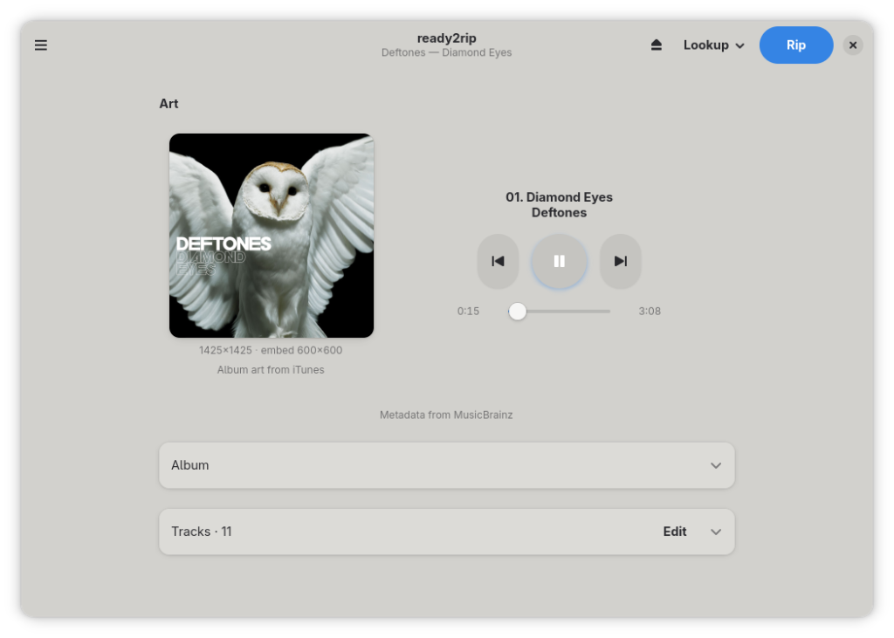
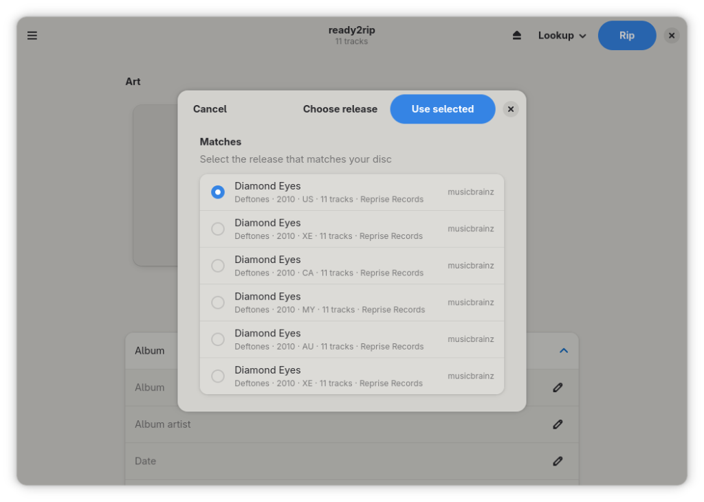
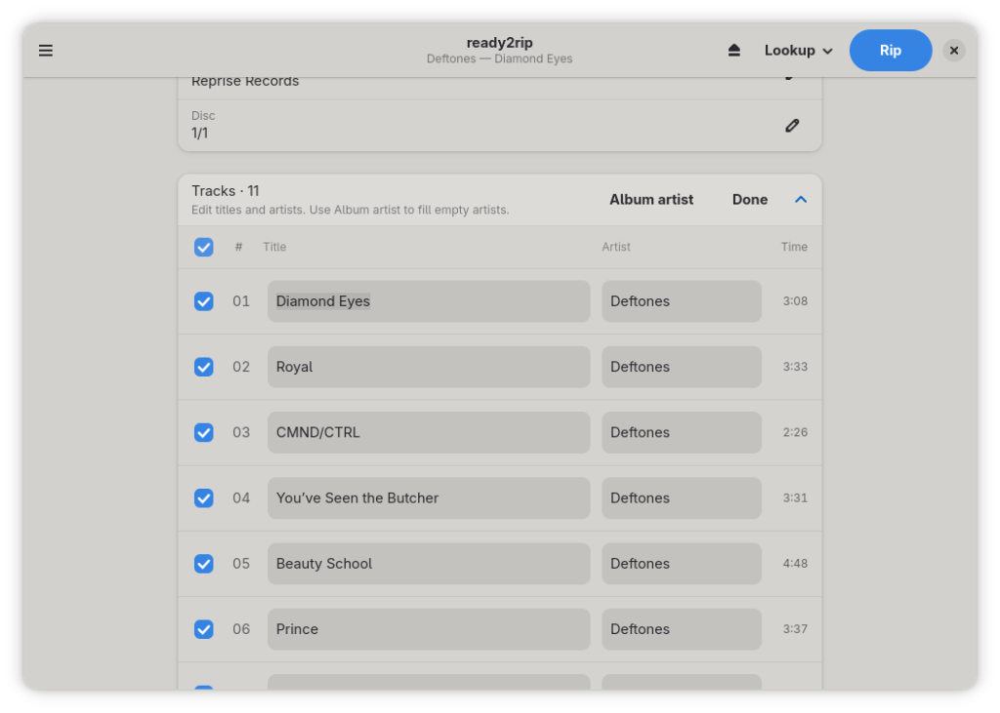
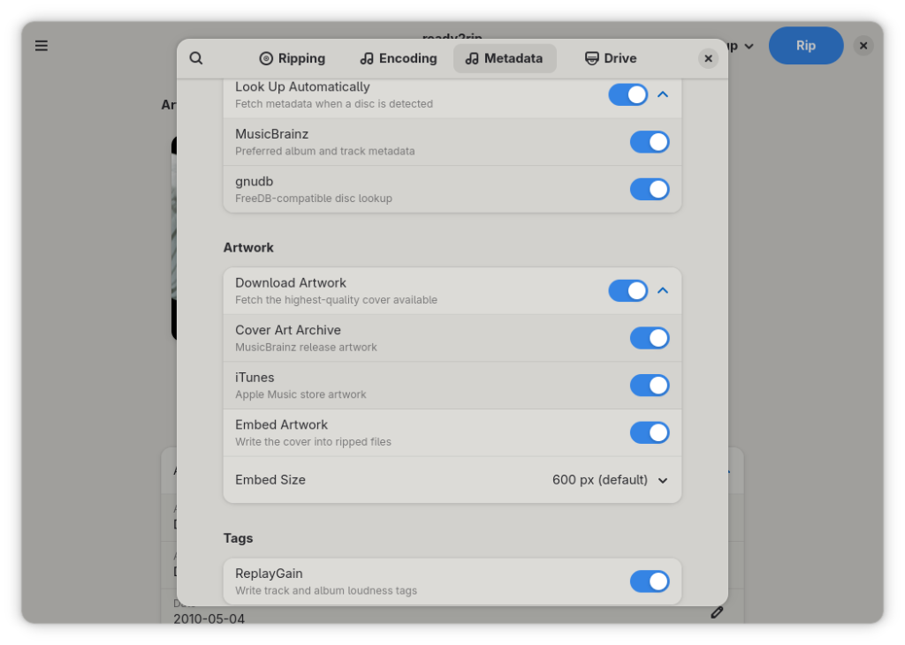
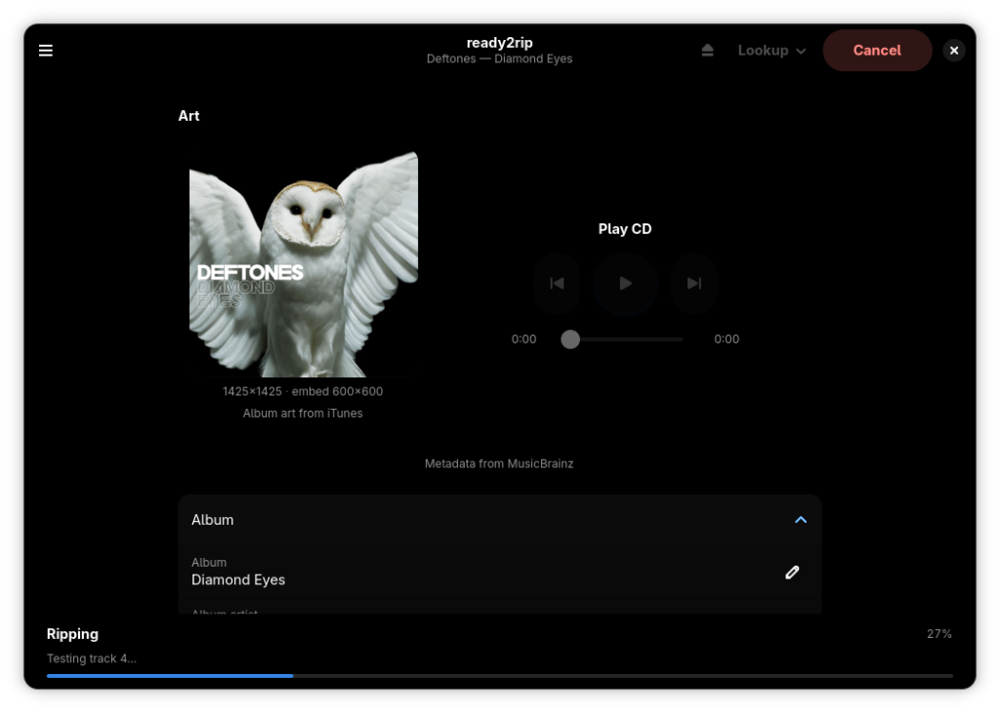

# ready2rip

**ready2rip is a secure CD ripper for Linux.**

A CD ripper focused on careful archival extraction with full cdparanoia,
AccurateRip verification, modern metadata, and various tag options, utilizing GNOME design.








## What it does

| Feature | Description |
|---------|-------------|
| Secure rip | Full cdparanoia, retries, optional test & copy |
| AccurateRip | Online CRC database check after extraction |
| Metadata | MusicBrainz + FreeDB-compatible (e.g. gnudb) |
| Tags | mutagen - FLAC / MP3 / AAC (M4A) / Opus / WAV |
| ReplayGain | Track + album loudness tags |
| Artwork | Cover Art Archive and iTunes, with optional embed sizes |
| Logs & CUE | Detailed rip log and multi-file / image CUE sheets |
| Drive setup | Sample offset, Accurate Stream, cache probe |

---

## Typical workflow

1. **Install / run** the AppImage (recommended: with [Gear Lever](https://flathub.org/apps/it.mijorus.gearlever) - see [Run the AppImage](#run-the-appimage)).
2. **Insert an audio CD.** ready2rip detects the disc, reads the TOC, and shows tracks.
3. **Drive setup** (first run, or when you change drives): calibrate **sample offset**, measure Accurate Stream / cache support.
4. **Metadata** (optional): auto-lookup when a disc is detected, or open **Lookup** → **By disc ID** and pick a release. If the wrong album is matched, use **Lookup** → **MusicBrainz link…** and paste a `musicbrainz.org/release/…` URL (or release UUID). Edit album/track fields if needed. Cover art can be fetched, chosen from disk, or cleared.
5. **Settings**: choose encoder, test & copy, CUE/log, Copy Image, HTOA, etc. Defaults already match a secure archival setup.
6. Press **Rip CD**. Progress appears in the bottom panel (status line shows track detail).
7. Files land under your **output folder** using the album/track templates. Open the folder to find audio, optional `cover`, **`.log`**, and **`.cue`**.

### What a secure rip does (under the hood)

ready2rip aims for secure archival ripping on Linux via cdparanoia / libcdio-paranoia:

| Step | Behaviour |
|------|-----------|
| Full paranoia | Overlap / jitter correction and multi-read repair (secure mode; not burst by default) |
| Never-skip + abort-on-skip | `--never-skip=500`, `-X`, and `-o 8` — keep re-reading imperfect data; force overlap search; don’t silently leave holes |
| Sample offset | Applied at extract time (`-O`) when calibrated (read offset correction) |
| Test and copy | Extract twice, compare CRC32; up to 3 secure retries on mismatch; defeat drive audio cache between passes; unmatched tracks fail the rip |
| AccurateRip | Verifies the offset-corrected audio against the public AR database |
| Error logging | Parses cdparanoia progress into quality / fixups / skips / suspicious positions |
| Burst fallback | Off by default. Optional insecure `-Z` recovery after secure retries fail — noted in the log |

**Copy Image** mode rips one continuous disc image (FLAC/WAV) instead of per-track files; enable **Write .cue file** for a matching image CUE. Per-track rips use a multi-file CUE (“left-out gaps”) when that option is on.

---

## Options

### Paths and naming

| Option | Default / notes |
|--------|------------------|
| **Optical device** | Usually `/dev/sr0` |
| **Output folder** | (`~/Music`) |
| **Album folder template** | `{album_artist}/{album}/{disc_folder}` - also `{year}`, `{disc}`, `{totaldiscs}` |
| **Track filename template** | `{track:02d} - {title}` - also `{artist}`, `{album}`, `{disc}`, `{totaldiscs}` |

### Encoder

| Option | Notes |
|--------|--------|
| **Encoder** | FLAC, MP3, AAC (M4A), Opus, or WAV |
| **FLAC compression** | 0 (fast) … 8 (smallest); default 5 |
| **MP3 quality** | LAME V0–V5 (VBR) or 128–320 kbps CBR |
| **AAC quality** | FDK VBR 1–5 or 128–320 kbps CBR (libfdk_aac when available) |
| **Opus bitrate** | VBR kbps (typical 96–256) |

Copy Image forces a lossless container (FLAC or WAV; other formats fall back to FLAC).

### Extraction

| Option | Default | Notes |
|--------|---------|--------|
| **Test and copy** | On | Two secure passes; matching CRCs required (retries on mismatch) |
| **Copy Image** | Off | One continuous image instead of separate tracks |
| **Pregap / HTOA** | On | Ignore ≤2s track-1 pause; longer non-silent pregap → track `00`; track 1 starts at index 01 |
| **AccurateRip** | On | Online CRC verification |
| **Burst fallback** | Off | Optional insecure `-Z` recovery after secure retries fail |
| **Write rip log** | On | Detailed status log in the album folder |
| **Write .cue file** | On | Multi-file CUE, or image CUE when Copy Image is on |
| **Auto-rip** | Off | Start rip shortly after a new disc is detected |
| **Auto-eject** | Off | Open tray after a successful rip |

### Drive / calibration

| Option | Notes |
|--------|--------|
| **Sample offset** | From Drive setup or [driveoffsets.htm](http://www.accuraterip.com/driveoffsets.htm) |
| **Drive setup** | Offset scan, Accurate Stream, audio cache |

### Metadata & art

| Option | Notes |
|--------|--------|
| **Look up automatically** | Query when a disc is detected |
| **MusicBrainz / FreeDB** | Sources for lookup |
| **Download artwork** | iTunes, Cover Art Archive |
| **Embed artwork** | Write cover into audio files; max embed edge size |
| **ReplayGain** | Track + album tags after the rip set is complete |

---

## Dependencies

### End users (AppImage)

Always required on the **host** (not shipped in the image):

| Requirement | Why |
|-------------|-----|
| **x86_64** Linux | AppImage architecture |
| **glibc** new enough for the build | See [Portability](#appimage-portability); `GLIBC_2.xx not found` means the image is newer than your distro |
| **Optical drive** + user in `cdrom` (or equivalent) | Read / eject the disc |
| **FUSE** (`libfuse2` / `fuse`) | Mount the AppImage (preferred over `APPIMAGE_EXTRACT_AND_RUN=1`) |
| **Graphics stack** (Mesa / Vulkan / libGL, Wayland or X11) | Display |

What the AppImage **tries to ship** (so you usually need zero encode packages):

| Inside the image | Guaranteed? |
|------------------|-------------|
| Python, GTK 4, libadwaita, mutagen, Pillow | Yes (required at build) |
| **cdparanoia** | Yes (build fails without it) |
| **flac**, **lame**, **ffmpeg**, **opusenc** | **Only if present on the build host** — otherwise omitted |

Optional: **GStreamer** CDDA plugins for in-app playback; ripping does not need them.

### Develop / run from source

| Dependency | Role |
|------------|------|
| Python 3 + **PyGObject** (Gtk 4, Adw 1) | UI |
| **cdparanoia** or **cd-paranoia** | TOC + secure extract |
| **mutagen** | Tags (FLAC / MP3 / AAC·M4A / Opus / WAV) + ReplayGain tag write |
| **Pillow** | Cover-art JPEG conversion |
| **flac** | FLAC encode |
| **lame** | MP3 encode |
| **ffmpeg** | AAC (M4A) encode, ReplayGain analysis (`ebur128`); Opus fallback |
| **opusenc** | Opus encode (preferred over ffmpeg for Opus) |
| **GStreamer** 1.x + `cdiocddasrc` or `cdparanoiasrc` | In-app CD playback (optional) |
| Meson, Ninja, gcc | Install / AppImage packaging |

```bash
# Python modules (Fedora: python3-mutagen python3-pillow)
pip3 install --user mutagen pillow
```

Optional:

| Dependency | Role |
|------------|------|
| **libfdk_aac** (in ffmpeg) | Higher-quality AAC with VBR + afterburner; native `aac` is used if missing |
| **libdiscid** | DiscID helpers via ctypes; pure-Python TOC IDs are used if missing |

Example system packages (names vary by distro):

```bash
# Fedora
sudo dnf install python3-gobject gtk4 libadwaita python3-mutagen python3-pillow \
  cdparanoia flac lame ffmpeg opus-tools gstreamer1-plugins-good

# Debian / Ubuntu
sudo apt install python3-gi gir1.2-gtk-4.0 gir1.2-adw-1 python3-mutagen python3-pil \
  cdparanoia flac lame ffmpeg opus-tools gstreamer1.0-plugins-good
```

### Build host (AppImage packaging)

| Required on build host | Why |
|------------------------|-----|
| `python3`, PyGObject, GTK 4, libadwaita | Bundled into the image (incl. Python stdlib) |
| `cdparanoia` / `cd-paranoia` | Bundled — build fails if missing |
| `meson`, `ninja`, `gcc`, `curl`, `pip` | Packaging |
| `flac`, `lame`, `ffmpeg`, `opusenc` (`opus-tools`) | **Install these before building** so they are copied into the image; otherwise end users must install them |
| `mutagen`, `Pillow` | Bundled into the image |
| `zsync` / **zsyncmake** | Recommended — produces `.zsync` for Gear Lever delta updates |

```bash
# Ensure encoders are on PATH, then:
./appimage/build-appimage.sh
# → dist/ready2rip-VERSION-x86_64.AppImage
```

The script **warns** (does not fail) if `flac` / `lame` / `ffmpeg` / `opusenc` are missing. Smoke-test only requires Python/GTK/mutagen/cdparanoia. Check the build log for `warning: flac not on host` etc. before publishing.

### AppImage portability

What is portable:

| Bundled | Independent of host? |
|---------|----------------------|
| Python + stdlib + PyGObject | Yes |
| ready2rip package, mutagen, Pillow | Yes |
| GTK 4 / Adwaita + most deps | Yes (best-effort) |
| cdparanoia | Yes (required at build) |
| flac, lame, ffmpeg, opusenc | Only if the **build host** had them |

What is **not** fully portable:

| Constraint | Why |
|------------|-----|
| **glibc version** | Linux cannot safely ship its own glibc in an AppImage. The image needs a host glibc **≥ the newest symbol used by bundled libs**. A build on a bleeding-edge distro (e.g. Solus with glibc 2.43) will **not** run on older Ubuntu/Debian. Prefer building releases on the **oldest supported target** (or a container of that vintage) when you need wide reach. |
| **GPU / display stack** | Mesa, libGL, Vulkan, Wayland/X11 client libs come from the host. |
| **Architecture** | x86_64 only (script enforces this). |

Check your system glibc with `ldd --version`. If the AppImage fails with `GLIBC_2.xx not found`, rebuild on an older base or run on a newer distro.

---

## Run the AppImage

### Download and run

1. Get the latest **`ready2rip-*-x86_64.AppImage`** from [GitHub Releases](https://github.com/gnostiko/ready2rip/releases).
2. Make it executable and start it:

```bash
chmod +x ready2rip-0.4.3-x86_64.AppImage
./ready2rip-0.4.3-x86_64.AppImage
```

### Recommended: manage with Gear Lever

For desktop integration (icons, menus) and **updates from GitHub**, use **[Gear Lever](https://flathub.org/apps/it.mijorus.gearlever)**:

```bash
flatpak install flathub it.mijorus.gearlever
```

Open the AppImage with Gear Lever (or add it from Gear Lever’s UI). ready2rip embeds AppImage update information at build time so Gear Lever can detect **GitHub Releases** automatically when both the `.AppImage` and `.AppImage.zsync` assets are published.


---

## Develop from source

### Run without installing

GSettings schemas compile into the user cache on first launch. From the repo:

```bash
./run
```

Equivalent:

```bash
PYTHONPATH=src python3 -m ready2rip.main
```

### Meson (install / packaging)

```bash
meson setup build
meson compile -C build
meson compile -C build run          # optional: run via the build env
meson setup build --prefix="$PWD/install" --reconfigure
meson install -C build
./install/bin/ready2rip
```

### Project layout

```text
ready2rip/
  run                   # source-tree launcher
  appimage/             # AppRun + build-appimage.sh
  data/                 # desktop, icons, AppStream, GSettings
  src/ready2rip/
  meson.build
```


---

## Inspired by

- [Exact Audio Copy](https://www.exactaudiocopy.de/)
- [dBpoweramp](https://www.dbpoweramp.com/)
- [cyanrip](https://github.com/cyanreg/cyanrip)


## License

GPL-3.0-or-later. See [LICENSE](LICENSE).

---

