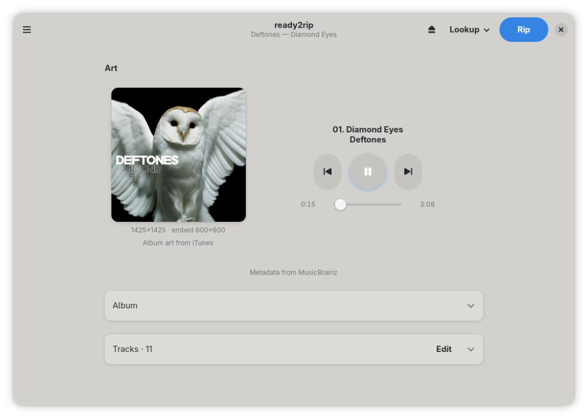
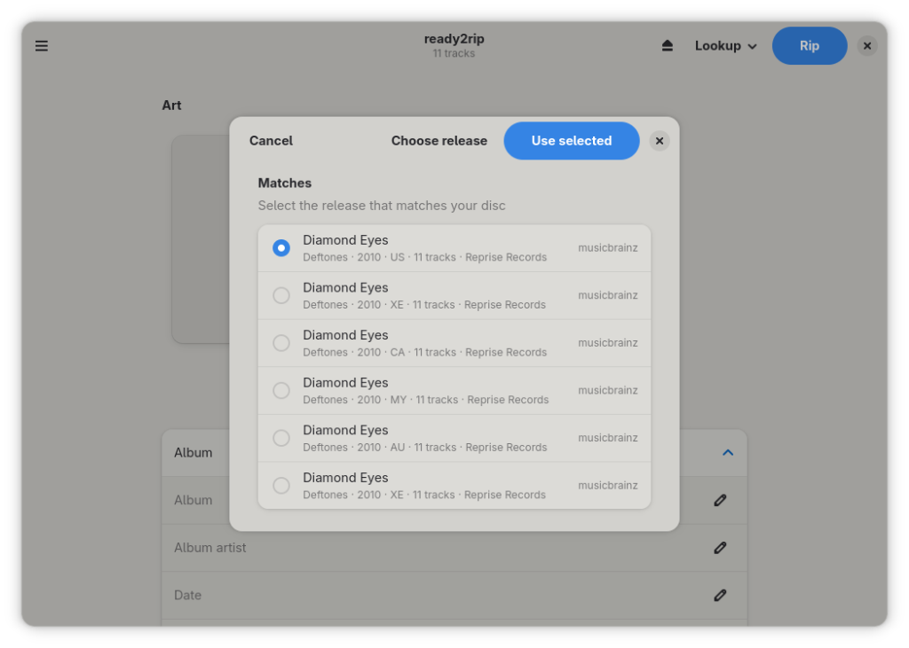
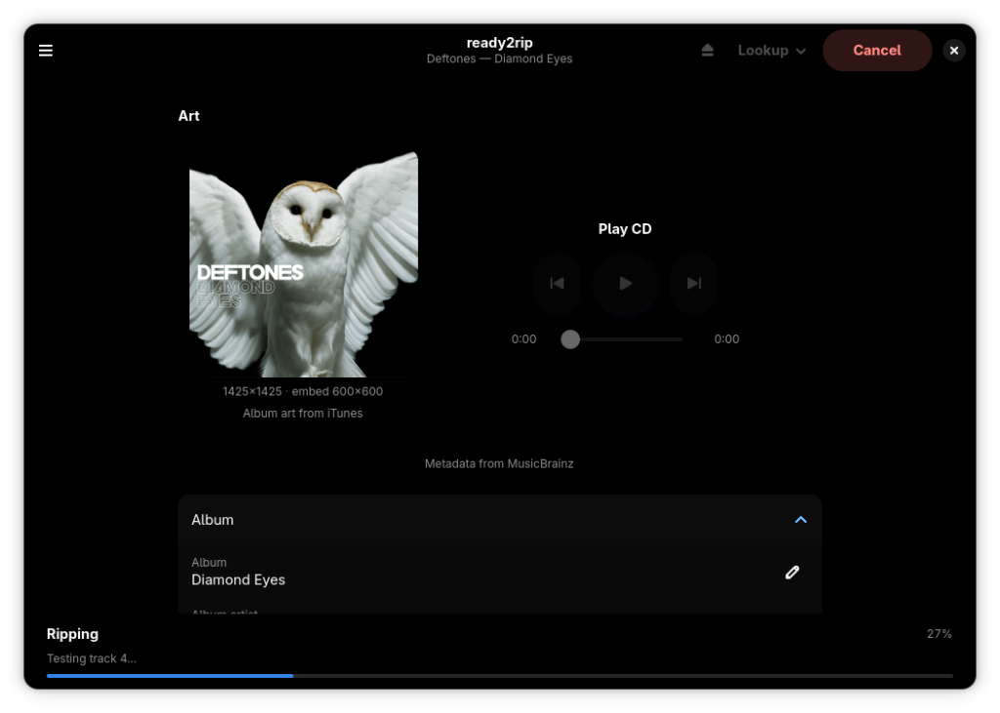

# ready2rip

Secure CD ripper for Linux — cdparanoia extraction, AccurateRip + CTDB verification, MusicBrainz metadata, and modern tagging in a GTK 4 / libadwaita UI.





## Features

- **Secure rip** — full cdparanoia, retries, optional test & copy
- **AccurateRip** + **CTDB** verification (optional CTDB submit)
- **Metadata** — MusicBrainz and FreeDB-compatible lookup; editable album/tracks
- **Encode** — FLAC, MP3, AAC (M4A), Opus, WAV via mutagen tags + ReplayGain
- **Artwork** — Cover Art Archive / iTunes, optional embed sizes
- **Logs & CUE** — rip log; multi-file or image CUE (INDEX 00 pregaps, mixed-mode data)
- **Drive setup** — sample offset calibration

## Install (AppImage)

1. Download the latest `ready2rip-*-x86_64.AppImage` from [Releases](https://github.com/gnostiko/ready2rip/releases).
2. Run it:

```bash
chmod +x ready2rip-0.4.11-x86_64.AppImage
./ready2rip-0.4.11-x86_64.AppImage
```

**Host needs:** x86_64 Linux, a new enough glibc for the build, FUSE (`libfuse2`), an optical drive (user in `cdrom`), and a normal GPU/display stack.

For icons, menus, and GitHub update checks, use **[Gear Lever](https://flathub.org/apps/it.mijorus.gearlever)**:

```bash
flatpak install flathub it.mijorus.gearlever
```

## Workflow

1. Insert an audio CD — TOC and tracks appear.
2. Calibrate **sample offset** in Drive setup when you first use a drive.
3. **Lookup** metadata (auto or by disc ID / MusicBrainz link); edit fields and art as needed.
4. Choose encoder and rip options in Settings (test & copy, CUE/log, Copy Image, HTOA, …).
5. **Rip CD** — progress shows in the bottom banner; files land under your output folder templates.

Secure mode uses full paranoia, never-skip / abort-on-skip, optional dual-pass CRC compare, then AccurateRip and CTDB. Burst (`-Z`) fallback is off by default.

## Develop from source

```bash
# Fedora
sudo dnf install python3-gobject gtk4 libadwaita python3-mutagen python3-pillow \
  cdparanoia flac lame ffmpeg opus-tools

# Debian / Ubuntu
sudo apt install python3-gi gir1.2-gtk-4.0 gir1.2-adw-1 python3-mutagen python3-pil \
  cdparanoia flac lame ffmpeg opus-tools
```

```bash
./run                          # or: PYTHONPATH=src python3 -m ready2rip.main
meson setup build && meson compile -C build
```

AppImage packaging (encoders on PATH are bundled when present):

```bash
./appimage/build-appimage.sh   # → dist/ready2rip-VERSION-x86_64.AppImage
```

Build on the oldest glibc you care about for wider AppImage reach — glibc is not bundled.

## Inspired by

[Exact Audio Copy](https://www.exactaudiocopy.de/) · [dBpoweramp](https://www.dbpoweramp.com/) · [cyanrip](https://github.com/cyanreg/cyanrip)

## License

GPL-3.0-or-later. See [LICENSE](LICENSE).
